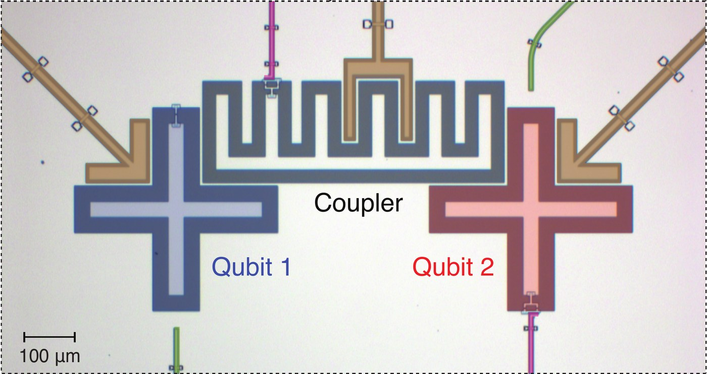
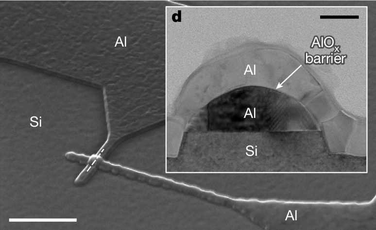
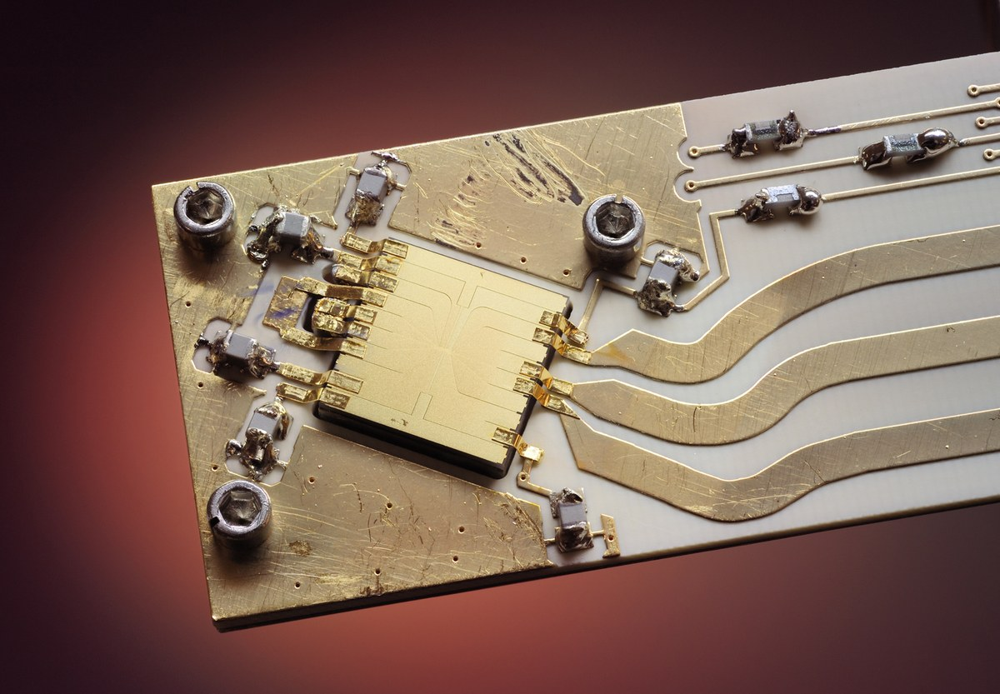
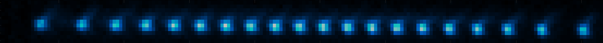

# Platforms, gates and measurement {#sec-platforms-gates-measurement}



On paper, a quantum algorithm is a circuit: gates on ideal qubits, followed by
measurements. A real quantum computer is a physical device, whose physics decides which
operations it can perform, between which qubits, how fast and how reliably. In this
chapter, we look at this physical side and at what it means for the circuits we can run.

By the end of the chapter, you should be able to explain what a quantum computer needs
from its qubits and how superconducting circuits and trapped ions provide it; why
devices have different native gates, why $Z$ rotations are usually free, and what
limited connectivity costs; and how many shots an expectation value needs and how long
they take.

## Noisy qubits and fault tolerance {#sec-nisq}

Every physical qubit is imperfect. Each gate has a small chance of going wrong, the
stored quantum state degrades even when nothing is done to it, and measurements
sometimes return the wrong result. These errors add up. If each gate fails with
probability 0.1%, a circuit of a thousand gates runs without any error only about 37% of
the time, since $0.999^{1000} \approx e^{-1}$. Noise therefore limits the size of the
circuits that a device can run usefully.

Preskill called the devices of this era [NISQ]{.gloss key="nisq"} devices, for *noisy
intermediate-scale quantum* [@preskill2018]. *Intermediate scale* means tens to
thousands of qubits, enough that many of their circuits are hard to simulate on a
classical computer, but far from the millions of qubits that the best-known quantum
algorithms need. *Noisy* means that their errors are not corrected.

Getting useful results from a NISQ device means working within the limit set by noise.
Circuits are kept short, so that errors have little chance to build up. The quantities
to keep small are the circuit's [depth]{.gloss key="depth"}, the number of layers of
gates that must run one after another, and its number of two-qubit gates, the least
reliable operations on current devices (@sec-noise-sources). Each run of a circuit
returns a single random outcome, so every quantity is estimated from many repetitions,
called shots (@sec-shots). And [error mitigation]{.gloss key="error-mitigation"}
reduces the effect of the remaining noise on these estimates, without correcting the
errors themselves, by running extra or modified circuits and combining their results.
Error mitigation is not the same as error correction: it only works if the circuit does
not accumulate too much error in the first place, and its price is running more shots.
We come back to it later in the course.

Correcting errors is possible in principle. [Quantum error correction]{.gloss key="qec"}
stores each qubit of information redundantly in many
[physical qubits]{.gloss key="physical-qubit"}, which together form one
[logical qubit]{.gloss key="logical-qubit"}. Repeated checks on the physical qubits
reveal errors without disturbing the stored information, so that the errors can be
undone. This only helps if the physical qubits are good enough. Below a certain error
rate per operation, the [threshold]{.gloss key="threshold"}, larger codes give lower
logical error rates, as low as a computation requires, and the computer is called
*fault tolerant*.

Fault tolerance is expensive. Useful algorithms are estimated to need of order a
thousand physical qubits for every logical qubit, and around a million physical qubits
in total [@fowler2012; @gidney2025]. Experiments are now crossing the threshold: in
2024, a superconducting device ran an error-correcting code whose logical error rate
halved each time the code was made larger [@google2025]. Such experiments use a whole
device to protect a single logical qubit, however, and useful computations still run on
physical qubits. We come back to the stage in between, *early fault tolerance*, at the
end of the course.

The cost of error correction is not only an increase in the number of physical qubits.
A code protects stored information, but every gate on logical qubits must also be
carried out without spreading errors, and only a small set of gates can be done this way
at a low cost. Every other gate has to be built from this set, so the operations that
are cheap on a NISQ device can be expensive on a fault-tolerant one, and the reverse. In the most studied
codes, a CNOT between two logical qubits is relatively cheap. A single-qubit rotation by
an arbitrary angle, which a NISQ device performs with a single pulse
(@sec-driving-gates), must instead be approximated by a sequence of tens to about a
hundred protected gates, some of which need a costly extra procedure of their own
[@ross2016; @litinski2019]. The cost of a NISQ circuit is dominated by its depth and its
two-qubit gates, while the cost of a fault-tolerant circuit is often dominated by its
number of rotations. @tbl-nisq-ftqc summarises the differences.

| | NISQ | Fault tolerant |
|---|---|---|
| Qubits | physical qubits | logical qubits, each encoded in many physical qubits |
| Errors | uncorrected; they accumulate with every operation | corrected, if the physical error rates are below the threshold |
| Circuit size | limited by noise | limited by the number of qubits and the run time |
| Cheap operations | single-qubit rotations at any angle | CNOT and a few other gates |
| Expensive operations | two-qubit gates | single-qubit rotations at arbitrary angles |
| Cost of a circuit | mainly its depth and number of two-qubit gates | mainly its number of rotations |
| Dealing with noise | short circuits, many shots, error mitigation | error correction |
| Status | available today | first demonstrations; useful machines still to be built |

: NISQ and fault-tolerant quantum computing compared. {#tbl-nisq-ftqc}

This course focuses on NISQ devices. We will learn how noise affects their results,
how error mitigation can reduce its effect, and which algorithms can be run on today's
devices.

## Physical qubits {#sec-platforms}

This section is a high-level introduction to the most common designs of two kinds of
hardware, superconducting circuits and trapped ions. Quantum hardware is a very active
field of research, and there are many variations on everything we describe here.
The device physics is descriptive, and you are not expected to derive it. What matters
later are its consequences for gates, connectivity and speed. Terms we leave unexplained
are in the glossary; on the web version, hover over an underlined term to see its
definition.

### Requirements for a quantum computer {#sec-qubit-needs}

A qubit is a quantum system with two states, $\ket{0}$ and $\ket{1}$, that we can
control. Quantum systems such as atoms and small electrical circuits can only take
certain values of energy, their *energy levels*, and they usually have many more than
two. Most qubits are therefore the two lowest energy levels of a larger system.
The other levels are still there, and a qubit can end up in them by accident.

A universal, [digital]{.gloss key="digital-qc"} quantum computer is built by assembling
many physical qubits and controlling them individually. DiVincenzo listed what this
requires [@divincenzo2000]:

- a scalable system of well-characterised qubits: their levels and interactions are
  known, and more qubits can be added;
- a way to prepare the qubits in a known state, usually $\ket{0\cdots 0}$;
- a universal set of gates, usually rotations of single qubits together with an
  interaction between two qubits;
- a way to measure individual qubits;
- [coherence times]{.gloss key="coherence-time"}, the times for which the qubits keep
  their quantum state, that are long compared with the duration of a gate.

These are the [DiVincenzo criteria]{.gloss key="divincenzo"}. Two further criteria
concern sending qubits between distant devices, which we will not need.

One property of measurement matters well before @sec-measurement, where readout is
described in detail. On the platforms in this chapter, a measurement asks each qubit
whether it is in $\ket{0}$ or in $\ket{1}$: it projects the qubit onto one of these two
states and returns one bit. This is a measurement in the *computational basis*, also
called the $Z$ basis, since $\ket{0}$ and $\ket{1}$ are the eigenstates of $Z$. To
measure in another basis, we first rotate that basis onto the computational one.

The requirements pull in opposite directions. A qubit keeps its state longest when it
is well isolated from its surroundings, since every interaction with the environment
disturbs it. Yet to apply gates and to measure, we have to interact with it, strongly
and quickly. Every platform is a compromise between isolation and control, and this
compromise explains many of the numbers in this chapter.

### Energy levels, frequencies and pulses {#sec-pulses}

Quantum mechanics links energy and frequency. An energy difference $E$ between two
levels corresponds to a frequency $f = E/h$, where $h$ is Planck's constant, and
radiation at that frequency drives transitions between the two levels, while radiation
at other frequencies hardly affects them. This selectivity is called
[resonance]{.gloss key="resonance"}, and on most platforms it is how qubits are
controlled.

A [pulse]{.gloss key="pulse"} is a short burst of radiation at a chosen frequency, the
carrier frequency, switched on and off smoothly. Its shape over time, the *envelope*, is
often close to a Gaussian (@fig-pulse a). Superconducting qubits are driven by
microwave pulses, trapped ions by laser or microwave pulses. A qubit with transition
frequency $f_q$ oscillates at that frequency too, and in a simplified picture, the effect
of a pulse on the qubit is the product of the pulse with this oscillation, added up over
time. If the two frequencies are equal, the product keeps the same sign, and its effect
builds up as long as the pulse lasts (@fig-pulse, left, b and c). The result is a rotation of
the qubit, by an angle proportional to the area under the envelope. If the frequencies
differ, the product alternates in sign, its contributions cancel, and the qubit is left
almost unchanged. A pulse at the frequency of one qubit therefore acts on that qubit, and
hardly on qubits with other frequencies. @sec-driving-gates shows how the shape and
timing of a pulse set the rotation.

![The same Gaussian pulse acting on a qubit at the carrier frequency (left) and on a qubit at a 35% higher frequency (right). (a) The pulse, with the qubit's own oscillation dashed; (b) the product of the two; (c) its running integral. The effect on the resonant qubit builds up to a value set by the area under the envelope; for the off-resonant qubit, it averages out to almost zero. The frequencies are scaled down to show the oscillations: a superconducting qubit oscillates a hundred times or more during a pulse, so that a much smaller difference in frequency is enough.](figures/pulse-resonance){#fig-pulse width=85%}

### Superconducting qubits {#sec-superconducting}

A superconducting qubit is a small electrical circuit on a chip. The chip is
*fabricated* like a conventional microchip: in a clean room, thin layers of
superconducting metal are deposited on it and etched into shape
(@fig-sc-chip). Once cooled, its metal becomes superconducting. Current then flows without resistance, so no energy is
lost as heat, and the circuit behaves as a quantum system with discrete energy levels;
we treat this part as a black box. A simple circuit of this kind has evenly spaced
levels, like a mass on a spring (@fig-energy-levels, left). That makes it useless as a
qubit, because a pulse at the frequency $f_{01}$ of the $\ket{0} \to \ket{1}$ transition
is just as resonant with $\ket{1} \to \ket{2}$, $\ket{2} \to \ket{3}$ and so on. A
circuit element called a [Josephson junction]{.gloss key="josephson-junction"} makes the
spacing uneven. In the most common design, the [transmon]{.gloss key="transmon"}, the
$\ket{1} \to \ket{2}$ transition is a few percent lower in frequency than the qubit
transition (@fig-energy-levels, right), so a pulse at $f_{01}$ drives only the qubit.

{#fig-energy-levels width=85%}

::: {#fig-sc-chip layout="[[62,38]]" layout-valign="center"}
{#fig-sc-transmons}

{#fig-sc-junction}

Superconducting qubits under the microscope. (a) Two transmon qubits (blue and red, false colour) with a third transmon between them, used as a tunable coupler (grey) [@sung2021]. The cross-shaped pads are the transmons' capacitors, and their Josephson junctions sit in the small structures at the ends of the arms. Qubit 2 and the coupler have two junctions in a loop, so that their frequencies can be tuned. Green lines carry the drive pulses, pink lines the currents that tune the frequencies, and the brown structures belong to the readout (@sec-readout). (b) A Josephson junction from a different device, seen in an electron microscope: two aluminium wires (Al) cross on a silicon chip (Si), separated by a thin oxide barrier, shown in cross-section in the inset [@vandamme2024]. Scale bars: 1 µm; inset, 50 nm. Both images adapted (cropped) under the [CC BY 4.0](https://creativecommons.org/licenses/by/4.0/) licence.
:::

Transmon frequencies are typically 4-6 GHz, in the microwave range. At room
temperature, the thermal energy is about a thousand times larger than $hf$, so heat
alone would excite the qubit at random. Superconducting chips therefore sit in a
[dilution refrigerator]{.gloss key="dilution-refrigerator"} at about 10 mK, a hundredth
of a degree above absolute zero (@exr-thermal), and cables bring the microwave pulses
down to them from electronics at room temperature.

The cold also prepares the qubits. At 10 mK, a qubit left alone loses its energy and falls
into $\ket{0}$ within a few hundred microseconds. This
[relaxation]{.gloss key="relaxation"} is a source of noise during a computation
(@sec-noise-sources), but between runs it initialises the qubits: we simply wait. A
faster approach to initialisation is *active reset*: measure the qubit (@sec-readout)
and apply an $X$ gate if the result is 1.

Superconducting qubits are fast. A transmon is large for a quantum system, a fraction of
a millimetre across, and it behaves like a small antenna that couples strongly to
microwaves, so a pulse of a few tens of nanoseconds is enough for a single-qubit gate.
The same antenna would pick up any stray radiation, so the chip is shielded, inside a
metal package and the nested shields of the refrigerator, and its control lines are
heavily filtered. Ideally, these lines are the qubit's only contact with the outside
world. The shielding is never perfect, and the quantum state of a qubit typically
survives for tens to hundreds of microseconds.

Each qubit has its own frequency, and this is how the qubits on a chip are addressed
separately. Every qubit usually has its own control line, but part of a pulse leaks to
the neighbouring qubits, and coupled qubits feel each other's drive. Neighbouring qubits
are therefore given different frequencies, so that a pulse meant for one of them is off
resonance for the others (@fig-pulse). In many designs, the frequency can also be
tuned. The Josephson junction is then replaced by a small loop with two junctions, and a
magnetic field through the loop, set by the current in a nearby control line, changes
the frequency of the qubit. Tuning lets the electronics move qubits towards each other
in frequency and away again, which is one way to switch on a two-qubit gate.

Fabrication is never perfectly precise, so no two qubits come out identical. Each has
its own frequency, its own coherence time and its own error rates. Every pulse must
therefore be [calibrated]{.gloss key="calibration"}: its frequency, strength and
duration are measured and adjusted, qubit by qubit and pair by pair, in a long sequence
of automated experiments. The properties of the qubits also drift, over hours to days,
so calibration is repeated regularly, and providers publish the resulting calibration
data for each qubit (@sec-noise-sources).

Two qubits can interact only if they are coupled, directly through a capacitor or
through a small circuit between them, a [coupler]{.gloss key="coupler"}
(@fig-sc-chip). The couplings
are built into the chip, so which pairs can interact is fixed when the chip is made
(@sec-connectivity). A coupling makes an interaction possible, and the electronics
decide when it acts. Like a qubit and a pulse, two coupled qubits exchange energy
efficiently only when their frequencies match. While their frequencies are kept apart,
or the coupler is tuned to cancel the coupling, they hardly interact. A two-qubit gate
switches the interaction on for a short time, by tuning the qubits or the coupler, or by
driving one of the qubits (@sec-driving-gates). The interaction never switches off
completely, and what remains is a source of errors called
[crosstalk]{.gloss key="crosstalk"}.

::: {#exr-thermal}
## Thermal excitation
In thermal equilibrium at temperature $T$, the excited and ground states of a qubit with
frequency $f$ are populated in the ratio $p_1/p_0 = e^{-hf/k_B T}$ (the Boltzmann
factor), where $k_B$ is Boltzmann's constant. Use $h/k_B \approx 0.048$ K/GHz.

(a) Compute $p_1/p_0$ for a 5 GHz qubit at room temperature (300 K), at 1 K and at 10 mK.

(b) Below which temperature is $p_1/p_0$ smaller than $10^{-3}$?

    :::: {.hint}
    Take the logarithm of both sides.
    ::::
:::

### Trapped ions {#sec-trapped-ions}

A trapped-ion qubit is a single [ion]{.gloss key="ion"}, an atom with one electron
removed, typically of ytterbium, barium or calcium. The electrons of an atom can only be
in certain states, each with its own energy. These are the atom's *internal* energy
levels, as opposed to the motion of the atom as a whole, which will also matter below.
Two of these levels form the qubit. All ions of an element are exactly the same, so,
unlike fabricated circuits, the qubits of an ion-trap computer are identical by nature.
As a consequence, they all have the same frequency, and a pulse cannot select one qubit
by its frequency. Instead, most designs aim a laser beam at a single ion
(@fig-ion-chain). In exchange, calibration is simpler, since all qubits share their
frequency and most of their properties.

The ions are held in vacuum by electric fields in an [ion trap]{.gloss key="ion-trap"},
lined up in a chain a few micrometres apart, and laser beams slow them down until they
are almost at rest ([laser cooling]{.gloss key="laser-cooling"}). Another laser pulse
then prepares each ion in $\ket{0}$ within microseconds (*optical pumping*). Laser beams, or in some
designs microwaves, also drive the gates. The qubit levels can be chosen so that stray
magnetic fields and other disturbances hardly affect them, and trapped-ion qubits keep
their quantum state for a second or more, thousands of times longer than superconducting
qubits. @fig-ion-photos shows a trap chip and a chain of ions.

::: {#fig-ion-photos}
{#fig-ion-trap width=70%}

{#fig-ion-string width=100%}

Trapped ions. (a) An ion trap made at NIST: a square gold chip, 7.4 mm on a side, on its circuit board. In experiments, two ions hover above the middle of the chip, and microwaves fed in through the three thick lines at the lower right drive their gates (photo: Y. Colombe/NIST, public domain). (b) Twenty calcium ions in a linear trap at Innsbruck, seen through the light they scatter: each bright spot is one ion, and the chain is about 0.1 mm long [@friis2018]. Adapted (cropped) under the [CC BY 4.0](https://creativecommons.org/licenses/by/4.0/) licence.
:::

The ions are charged and repel each other, so the chain behaves like a row of balls
joined by springs (@fig-ion-chain). Push one ion, and the whole chain starts to vibrate.
Like the internal energy of an atom, the energy of these vibrations comes in
discrete units, called [phonons]{.gloss key="phonon"}. Every ion takes part in the same
vibrations, so they act as a shared channel, the
[phonon bus]{.gloss key="phonon-bus"}, through which any ion can interact with any
other. The two-qubit gates are built by exploiting this phonon bus, so they can be
applied to any pair of qubits: the connectivity is all-to-all (@sec-connectivity).

{#fig-ion-chain width=85%}

This comes at the cost of speed. Gates that use the phonon bus take from tens of
microseconds to about a millisecond, roughly a thousand times longer than
superconducting gates, and they become slower and harder to control as the chain grows.
To scale up, some devices, such as Quantinuum's, divide the trap into zones and move
ions between them, bringing the two ions of each gate together
([QCCD]{.gloss key="qccd"}).

### Other platforms {#sec-other-platforms}

Several other platforms are developing quickly, following the same recipe of a
two-level system, a way to drive it, an interaction between qubits and a readout. In
*neutral-atom* devices, uncharged atoms are held, and can be moved, by tightly focused
laser beams ([optical tweezers]{.gloss key="optical-tweezers"}), and they interact when
lasers excite them to very large [Rydberg states]{.gloss key="rydberg"}; arrays of
hundreds to thousands of atoms have been built [@henriet2020]. *Photonic* devices carry
qubits on particles of light, which hardly interact with their surroundings but, for the
same reason, hardly with each other either, so their entangling operations succeed only
some of the time [@slussarenko2019]. *Spin qubits* use the [spin]{.gloss key="spin"} of
single electrons trapped in tiny semiconductor structures
([quantum dots]{.gloss key="quantum-dot"}); they can be made with the techniques of the
chip industry, but current devices have at most a few tens of qubits [@burkard2023].
@tbl-platforms compares the five platforms.

| Platform | Qubit | Two qubits interact through | Strengths | Main limitations |
|---|---|---|---|---|
| Superconducting | energy levels of a circuit on a chip | couplings built into the chip | fast gates; mature fabrication technology | short coherence; fixed connectivity; qubits not identical |
| Trapped ions | energy levels of an ion | shared vibrations of the chain | identical qubits; long coherence; any pair can interact | slow gates; long chains are hard to control |
| Neutral atoms | energy levels of an atom | excitation to large Rydberg states | many qubits; atoms can be rearranged | slow; atoms get lost and must be replaced |
| Photonics | a photon | interference and detection | little decoherence; photons travel far | entangling operations often fail; photons get lost |
| Spin qubits | spin of an electron | neighbouring electrons | very small; chip-industry fabrication | few qubits so far; qubits not identical |

: Platforms for gate-based quantum computing, compared. {#tbl-platforms}

## Native gates and connectivity {#sec-native-gates}

The circuits we write can use any gate that is convenient. A device, however,
implements only a small set of [native gates]{.gloss key="native-gate"}, each one a
calibrated pulse or a short sequence of pulses, and it applies two-qubit gates only
between pairs of qubits that are physically coupled. An additional step, compilation,
translates every circuit into these native operations. This section explains which gates
are native and why, and what the translation costs.

### Pauli rotations {#sec-pauli-rotations}

Recall the Pauli matrices
$$
X = \begin{pmatrix} 0 & 1 \\ 1 & 0 \end{pmatrix}, \qquad
Y = \begin{pmatrix} 0 & -i \\ i & 0 \end{pmatrix}, \qquad
Z = \begin{pmatrix} 1 & 0 \\ 0 & -1 \end{pmatrix}.
$$
They are Hermitian and square to the identity, $X^2 = Y^2 = Z^2 = I$. Any two different
Pauli matrices anticommute, for example $XZ = -ZX$, and the product of two of them is
the third, up to a factor: $XY = iZ$, $YZ = iX$ and $ZX = iY$. On several qubits, we
combine them with tensor products.

::: {#def-pauli-string}
## Pauli string
A [Pauli string]{.gloss key="pauli-string"} on $n$ qubits is a tensor product
$P = P_1 \otimes P_2 \otimes \cdots \otimes P_n$ with each $P_j \in \{I, X, Y, Z\}$.
We often drop the tensor product signs and write, for example, $ZZ$ or $XIY$.
:::

A Pauli string is again Hermitian, and it squares to the identity, because the square of
a tensor product is the tensor product of the squares:
$P^2 = P_1^2 \otimes \cdots \otimes P_n^2 = I$. This one property gives a closed formula
for the exponential of $P$. Expand the exponential as a power series. Even powers of $P$
are the identity, $P^{2m} = I$, and odd powers are $P^{2m+1} = P$, so the series splits
into two:
$$
e^{-i\theta P/2}
= \sum_{m=0}^{\infty} \frac{(-1)^m}{(2m)!}\left(\frac{\theta}{2}\right)^{2m} I
\;-\; i \sum_{m=0}^{\infty} \frac{(-1)^m}{(2m+1)!}\left(\frac{\theta}{2}\right)^{2m+1} P .
$$
These are the power series of the cosine and the sine, so
$$
e^{-i\theta P/2} = \cos\frac{\theta}{2}\, I - i \sin\frac{\theta}{2}\, P .
$$ {#eq-pauli-rotation}
The derivation used only $P^2 = I$, so @eq-pauli-rotation holds for any operator with
that property. Such operators are called *involutory*. For Hermitian operators, like
all those in this chapter, being involutory is the same as being a *reflection*: the
eigenvalues are $\pm 1$, so the operator flips the sign of one subspace and leaves the
orthogonal subspace unchanged.

Applied to single Pauli matrices, @eq-pauli-rotation gives the familiar rotations of a
qubit about the axes of the Bloch sphere, for example
$$
R_X(\theta) = e^{-i\theta X/2} = \begin{pmatrix} \cos\frac{\theta}{2} & -i\sin\frac{\theta}{2} \\
-i\sin\frac{\theta}{2} & \cos\frac{\theta}{2} \end{pmatrix}, \qquad
R_Z(\theta) = e^{-i\theta Z/2} = \begin{pmatrix} e^{-i\theta/2} & 0 \\ 0 & e^{i\theta/2} \end{pmatrix}.
$$ {#eq-rx-rz}
Rotations about two different axes are enough to build any single-qubit gate. Up to a
global phase, every single-qubit unitary can be written as
$R_Z(\alpha)\,R_Y(\beta)\,R_Z(\gamma)$ for some angles [@nielsen2010, sec. 4.2].

Applied to the two-qubit Pauli string $Z \otimes Z$, @eq-pauli-rotation gives

$$
R_{ZZ}(\theta) = e^{-i\theta\, Z\otimes Z/2}
= \begin{pmatrix}
e^{-i\theta/2} & 0 & 0 & 0 \\
0 & e^{i\theta/2} & 0 & 0 \\
0 & 0 & e^{i\theta/2} & 0 \\
0 & 0 & 0 & e^{-i\theta/2}
\end{pmatrix}
$$ {#eq-rzz}

in the basis $\ket{00}, \ket{01}, \ket{10}, \ket{11}$. $R_{ZZ}$ applies a phase that
depends only on whether the two bits are equal or different, their parity. That is why
it can be built from two CNOTs and a single $R_Z$ (@fig-rzz). The first CNOT writes the
parity of the two bits into the second qubit, $R_Z$ applies the phase, and the second
CNOT undoes the first. @sec-compiling extends this construction to rotations about any
Pauli string, built from native gates.

{#fig-rzz width=40%}

@eq-pauli-rotation will come back several times in this course, in circuits for time
evolution, which are built from Pauli rotations, and in the parameter-shift rule, which
gives exact gradients of variational circuits.

### Physical implementation of gates {#sec-driving-gates}

The native gates of a qubit platform are set by the physical mechanisms that control
its qubits. This section describes these mechanisms, for single-qubit and for two-qubit
gates, and the gates they produce.

A single-qubit gate on a superconducting qubit is a microwave pulse at the qubit's
frequency, a few tens of nanoseconds long (@sec-pulses). The area under the envelope of
the pulse, set by its strength and duration, sets the rotation angle $\theta$
(@fig-pulse). The phase of the pulse, that is, the timing of the microwave oscillation
relative to a reference clock in the control electronics, sets the axis of rotation,
which lies in the $xy$-plane of the Bloch sphere at an angle $\varphi$ from the
$x$-axis. Delaying the oscillation by a fraction of its period turns the axis by the
same fraction of a full turn. Laser or microwave pulses on trapped ions work in the same
way. On both platforms, the natural single-qubit gate is therefore a rotation by any
angle about any axis in the $xy$-plane, which IQM calls $\gate{PRX}$:

$$
\gate{PRX}(\theta,\varphi) = \exp\!\left[-i\frac{\theta}{2}\left(\cos\varphi\, X + \sin\varphi\, Y\right)\right].
$$ {#eq-prx}
The operator $\cos\varphi\, X + \sin\varphi\, Y$ squares to the identity
(@exr-prx), so @eq-pauli-rotation applies to it too. For $\varphi = 0$ and
$\varphi = \pi/2$, PRX reduces to $R_X(\theta)$ and $R_Y(\theta)$. @fig-prx shows how
$\gate{PRX}$ rotates the Bloch sphere. Rotations about the $z$-axis are missing
from this family, and @sec-virtual-z shows that they need no pulse at all.

::: {#fig-prx}
::: {.content-visible when-format="html"}

:::
::: {.content-visible unless-format="html"}
{width=45%}
:::

The Bloch sphere rotated by $\gate{PRX}(\theta,\varphi)$, a rotation by $\theta$ about the axis in the $xy$-plane at an angle $\varphi$ from the $x$-axis. The blue path shows where $\ket{0}$ goes as the rotation angle grows from $0$ to $\theta$. In the web version, the figure is interactive: the sliders set $\theta$ and $\varphi$, the blue grid turns with the sphere, and dragging changes the view. Below the sphere, a schematic of the pulse: its area, set by its amplitude at a fixed duration, gives $\theta$, and its phase, a delay against the reference clock (dashed), gives $\varphi$. The button plays the pulse, and the sphere turns as the area builds up.
:::

::: {#exr-prx}
## The PRX gate
(a) Show that $(\cos\varphi\, X + \sin\varphi\, Y)^2 = I$.

    :::: {.hint}
    Expand the square, and use that $X$ and $Y$ anticommute.
    ::::

(b) Write $\gate{PRX}(\theta,\varphi)$ as a $2\times 2$ matrix.

    :::: {.hint}
    Use @eq-pauli-rotation, which applies because of (a).
    ::::

(c) Check that $\gate{PRX}(\theta,0) = R_X(\theta)$ and
$\gate{PRX}(\theta,\pi/2) = R_Y(\theta)$. Which rotation is $\gate{PRX}(\theta,\pi)$?
:::

During a two-qubit gate, the two qubits should interact, and at all other times they
should not (@sec-superconducting). Superconducting devices switch the interaction on in
three main ways, and each gives a different native gate.

- **Tuning two qubits into resonance.** When two coupled qubits have the same frequency,
  an excitation moves back and forth between them: $\ket{01}$ turns into $\ket{10}$ and
  back again, while $\ket{00}$ and $\ket{11}$ are unchanged. A complete transfer gives
  the iSWAP gate, which exchanges $\ket{01}$ and $\ket{10}$ and multiplies both by $i$.
  Stopping halfway gives its square root, $\sqrt{\gate{iSWAP}}$.
- **Using the third level.** A transmon has a third level, $\ket{2}$, not far above the
  qubit levels (@fig-energy-levels). The frequencies can be tuned so that the two-qubit
  state $\ket{11}$ has the same energy as $\ket{20}$, in which the first transmon holds
  both excitations. These two states then exchange instead. After one complete exchange,
  there and back, $\ket{11}$ returns with its sign flipped (up to phases on the single
  qubits, which are easy to correct), while $\ket{00}$, $\ket{01}$
  and $\ket{10}$, which have no partner at the same energy, are unchanged. This is the
  controlled-Z gate, CZ, which flips the sign of $\ket{11}$ only. On most current
  devices, a tunable coupler between the qubits switches the interaction, and CZ is the
  most common native gate.
- **Driving one qubit at its neighbour's frequency.** IBM's older Eagle devices, retired
  in 2026, have qubits with fixed frequencies and couplings that are always on. A pulse on one qubit at the
  frequency of its neighbour ([cross-resonance]{.gloss key="cross-resonance"}) makes the
  neighbour rotate about its $x$-axis, in a direction that depends on the state of the
  first qubit: a rotation generated by $Z\otimes X$. In practice, it is applied as a gate
  called ECR, for echoed cross-resonance, which equals a CNOT up to single-qubit gates.

On trapped ions, laser beams on two ions couple their qubit states to the shared
vibrations of the chain, the phonon bus of @sec-trapped-ions. The light pushes each ion
with a force that depends on its qubit state, so the chain vibrates in a way that
depends on both qubits, and through this vibration the two qubits interact. At
the end of the gate the vibration returns to its starting state, so that it carries away
no information about the qubits. This
[Mølmer-Sørensen gate]{.gloss key="molmer-sorensen"} is a rotation generated by
$X \otimes X$, of the form of @eq-pauli-rotation, with an angle set by the duration and
strength of the laser pulses. It is available at any angle, from small rotations up to
a maximally entangling one, and between any pair of ions in the chain. Combined
with single-qubit rotations, it gives $R_{ZZ}(\theta)$ at any angle, the native
two-qubit gate of current trapped-ion devices.

### Native gate sets {#sec-native-gate-sets}

@tbl-native lists the native gates of some current devices. Names and details change
with each hardware generation, but the pattern stays the same: a continuous family of
single-qubit rotations, and one or a few entangling gates. Together they are
universal, so any circuit can be compiled into them, at the cost of extra gates.

| Device family | Single-qubit | Two-qubit |
|---|---|---|
| IQM (superconducting) | $\gate{PRX}(\theta,\varphi)$ | CZ; on star devices, also MOVE to and from the central resonator |
| IBM (superconducting) | $\sqrt{X}$, $X$; experimental: $R_X(\theta)$ | CZ (Heron, Nighthawk); ECR on the retired Eagle devices; experimental: $R_{ZZ}(\theta)$ |
| Google (superconducting) | PhasedXZ | CZ (Willow); $\sqrt{\gate{iSWAP}}$ and others on the older Sycamore |
| Quantinuum (trapped ions) | $R_{xy}(\theta,\varphi)$ | $R_{ZZ}(\theta)$, any angle |
| IonQ (trapped ions) | GPi($\varphi$), GPi2($\varphi$) | MS (Aria), ZZ($\theta$) (Forte), any angle |

: Native gates of some current devices, as of 2026. All of them also offer virtual $Z$ rotations (@sec-virtual-z). {#tbl-native}

The single-qubit gates in the table are rotations about axes in the $xy$-plane under
different names, in one case followed by a $Z$ rotation:

- $\sqrt{X}$ and $X$ (IBM) are $R_X(\pi/2)$ and $R_X(\pi)$, up to a global phase; IBM's
  Heron devices also offer $R_X(\theta)$ at any angle, as an experimental option;
- PhasedXZ (Google) is an $xy$-plane rotation followed by a $Z$ rotation;
- $R_{xy}(\theta,\varphi)$ (Quantinuum, also called U1q) is $\gate{PRX}(\theta,\varphi)$
  under another name;
- GPi($\varphi$) and GPi2($\varphi$) (IonQ) are $\gate{PRX}(\pi,\varphi)$ and
  $\gate{PRX}(\pi/2,\varphi)$, up to a global phase. IonQ measures angles in *turns*,
  so that an angle of 1 is a full turn, $2\pi$.

The two-qubit gates are either fixed gates or rotations with an adjustable angle. The
fixed ones are CZ, $\sqrt{\gate{iSWAP}}$ and ECR. In the basis
$\ket{00}, \ket{01}, \ket{10}, \ket{11}$,
$$
\gate{CZ} = \begin{pmatrix} 1&0&0&0\\ 0&1&0&0\\ 0&0&1&0\\ 0&0&0&-1 \end{pmatrix}, \qquad
\sqrt{\gate{iSWAP}} = \begin{pmatrix} 1&0&0&0\\ 0&\frac{1}{\sqrt2}&\frac{i}{\sqrt2}&0\\ 0&\frac{i}{\sqrt2}&\frac{1}{\sqrt2}&0\\ 0&0&0&1 \end{pmatrix},
$$
and ECR equals a CNOT up to single-qubit gates on both qubits. The adjustable ones are
$R_{ZZ}(\theta)$ of @eq-rzz, IonQ's ZZ($\theta$), which is the same gate with its angle
in turns, and the Mølmer-Sørensen gate MS, generated by $X \otimes X$. With an adjustable angle, an
entangling rotation of any strength is a single native gate, which saves gates in
circuits built from Pauli rotations.

### Compiling into native gates {#sec-compiling}

Compiling a circuit into native gates relies on an identity that we will use several
times: conjugating an exponential conjugates its exponent,
$$
U e^{A}\, U^\dagger = e^{U A U^\dagger}
$$ {#eq-conjugation}
for any unitary $U$ and any square matrix $A$. To see this, expand both sides as power
series: the inner factors $U^\dagger U = I$ cancel in $(UAU^\dagger)^k = U A^k U^\dagger$.
For a Pauli rotation, @eq-conjugation says that
$U e^{-i\theta P/2} U^\dagger = e^{-i\theta\, UPU^\dagger/2}$: conjugated by $U$, a
rotation about $P$ becomes a rotation about $UPU^\dagger$, by the same angle. To rotate
about a long Pauli string, it is therefore enough to find a circuit $U$ of native gates
that turns a simple Pauli matrix, such as $X$ on a single qubit, into that string.

Two kinds of conjugation do the job. First, single-qubit rotations turn one Pauli
matrix into another; for example, $R_Y(\pi/2)$ turns $Z$ into $X$, and $R_X(-\pi/2)$
turns $Z$ into $Y$ (@exr-pauli-conjugation). Second, CZ attaches a $Z$ to an $X$ on the
other qubit:
$$
\gate{CZ}\,(I\otimes X)\,\gate{CZ} = Z\otimes X .
$$
To check this, apply both sides to a basis state $\ket{ab}$. On the left, the first CZ
gives a sign $(-1)^{ab}$, $X$ flips $b$, and the second CZ gives a sign
$(-1)^{a(1-b)}$, so the result is $(-1)^{a}\ket{a,1-b}$, which is the action of
$Z \otimes X$. Each further CZ on the same qubit attaches one more $Z$: writing
$\gate{CZ}_{jk}$ for a CZ on qubits $j$ and $k$, and labelling single-qubit Paulis by
their qubit, conjugation by $\gate{CZ}_{13}\gate{CZ}_{23}$ turns $X_3$ into
$Z_1 Z_2 X_3$. Single-qubit conjugations then turn each factor into the Pauli matrix we
need. @fig-pauli-rotation shows the result for $P = Z\otimes Y\otimes X$. Every gate in
it is native on a device with PRX and CZ, since $R_X(\alpha) = \gate{PRX}(\alpha, 0)$.

{#fig-pauli-rotation width=60%}

A rotation about a Pauli string on $k$ qubits costs $2(k-1)$ CZs this way, the same
number of two-qubit gates as the CNOT construction of @fig-rzz. In @fig-pauli-rotation,
all CZs act on the qubit that carries the rotation, which suits a device where that
qubit is coupled to all the others. On a line of qubits, a chain of CNOTs between
neighbours collects the parity step by step instead, and each CNOT is one CZ between two
single-qubit rotations (@exr-swap-native).

::: {#exr-pauli-conjugation}
## Turning one Pauli into another
Let $P$ and $Q$ be Pauli strings that anticommute, $PQ = -QP$.

(a) Show that $e^{-i\alpha P/2}\, Q\, e^{i\alpha P/2} = \cos\alpha\, Q - i\sin\alpha\, PQ$.

    :::: {.hint}
    Write both exponentials with @eq-pauli-rotation, and use $PQP = -Q$.
    ::::

(b) Show that $R_Y(\pi/2)$ turns $Z$ into $X$, and that $R_X(-\pi/2)$ turns $Z$ into
$Y$.

    :::: {.hint}
    Use (a), and the products of Pauli matrices.
    ::::

(c) Check that the circuit of @fig-pauli-rotation implements
$e^{-i\theta\, Z\otimes Y\otimes X/2}$.

    :::: {.hint}
    Use @eq-conjugation, the identity for CZ in the text, and (b).
    ::::

(d) Draw a circuit of CZ gates and $R_X$ or $R_Y$ rotations for $R_{ZZ}(\theta)$, and
compare it with @fig-rzz.

    :::: {.hint}
    Start from $R_X(\theta)$ on the second qubit, conjugate it by CZ, then turn the remaining $X$ into $Z$.
    ::::
:::

### Virtual Z gates {#sec-virtual-z}

$\gate{PRX}$ contains no rotations about the $z$-axis, yet circuits are full of them,
for example in the decomposition $R_Z(\alpha)\,R_Y(\beta)\,R_Z(\gamma)$ of a general
single-qubit gate (@sec-pauli-rotations) and in many parametrised gates of
algorithms. On most devices, superconducting and trapped-ion alike, $Z$ rotations
are implemented without any pulse, as [virtual Z gates]{.gloss key="virtual-z"}. The
trick follows from Pauli algebra.

Conjugation by a $Z$ rotation rotates $X$ and $Y$ within the $xy$-plane:
$$
R_Z(\alpha)\, X\, R_Z(\alpha)^\dagger = \cos\alpha\, X + \sin\alpha\, Y, \qquad
R_Z(\alpha)\, Y\, R_Z(\alpha)^\dagger = \cos\alpha\, Y - \sin\alpha\, X
$$
(@exr-virtual-z). By the angle-addition formulas, it therefore maps
$\cos\varphi\, X + \sin\varphi\, Y$ to $\cos(\varphi+\alpha)\, X + \sin(\varphi+\alpha)\, Y$.
By @eq-conjugation, conjugating a $\gate{PRX}$ pulse by a $Z$ rotation
therefore shifts its phase:
$$
R_Z(\alpha)\, \gate{PRX}(\theta,\varphi)\, R_Z(\alpha)^\dagger = \gate{PRX}(\theta,\varphi+\alpha).
$$ {#eq-virtual-z}
Replacing $\alpha$ by $-\alpha$ and multiplying by $R_Z(\alpha)$ on the left gives
$$
\gate{PRX}(\theta,\varphi)\, R_Z(\alpha) = R_Z(\alpha)\, \gate{PRX}(\theta,\varphi-\alpha).
$$ {#eq-virtual-z-push}
Operators act from right to left, so on the left-hand side $R_Z(\alpha)$ acts first and
the pulse second. On the right-hand side, the pulse acts first, with its phase shifted
by $-\alpha$. A $Z$ rotation can therefore be moved later in a circuit, past a pulse, by
changing the pulse's phase.

Now take a circuit with a $Z$ rotation on one qubit (@fig-vz-before), and move the $Z$
rotation forward in time. Each $\gate{PRX}$ it passes gets its phase shifted by
$-\alpha$. CZ is diagonal, like $R_Z$, so the two commute and the $Z$ rotation passes
through unchanged. At the end, the $Z$ rotation sits just before a measurement in the
computational basis. A measurement only asks whether each qubit is in $\ket{0}$ or in
$\ket{1}$ (@sec-qubit-needs), and the $Z$ rotation only changes the phases of
$\ket{0}$ and $\ket{1}$, not the probabilities of measuring them, so it can be dropped.
The result (@fig-vz-after) contains no $Z$ rotation at all.

::: {#fig-virtual-z layout-ncol=2}
{#fig-vz-before}

{#fig-vz-after}

Two circuits that give the same measurement statistics.
:::

In hardware, the phase of each pulse, microwave or laser, is measured against a
reference clock in the control electronics, and a virtual $Z$ gate shifts that reference
for all later pulses on the qubit. It is an instruction to the electronics, carried out
instantly and exactly, so $Z$ rotations take no time and add no error. When we estimate
the error of a circuit, only the other gates count.

The same trick makes every single-qubit gate cost a single pulse. Write the gate as
$R_Z(\alpha)\,R_Y(\beta)\,R_Z(\gamma)$, note that $R_Y(\beta) = \gate{PRX}(\beta, \pi/2)$,
and move $R_Z(\gamma)$ past the pulse with @eq-virtual-z-push:
$$
R_Z(\alpha)\,R_Y(\beta)\,R_Z(\gamma) = R_Z(\alpha+\gamma)\,\gate{PRX}(\beta, \pi/2-\gamma).
$$
That is one pulse, followed by a $Z$ rotation that is virtual.

::: {#exr-virtual-z}
## Virtual Z gates
(a) Show that $R_Z(\alpha)\, X\, R_Z(\alpha)^\dagger = \cos\alpha\, X + \sin\alpha\, Y$ and
$R_Z(\alpha)\, Y\, R_Z(\alpha)^\dagger = \cos\alpha\, Y - \sin\alpha\, X$.

    :::: {.hint}
    Use @exr-pauli-conjugation (a) with $P = Z$.
    ::::

(b) Write the Hadamard gate, up to a global phase, as a single $\gate{PRX}$ pulse
followed by a $Z$ rotation.

    :::: {.hint}
    Write the Hadamard gate as $R_Z(\alpha)\,R_Y(\beta)\,R_Z(\gamma)$ first, then use @eq-virtual-z-push.
    ::::
:::

### Connectivity {#sec-connectivity}

A native two-qubit gate is available only between qubits that are physically coupled.
The [coupling graph]{.gloss key="coupling-graph"} of a device records which pairs these
are. Its vertices are the qubits, and an edge joins two qubits if a native two-qubit gate
can act on them (@fig-coupling-graphs).

On a superconducting chip, the coupling graph is fixed when the chip is made. In a
square lattice, used by Google, IQM and IBM's newest devices, each qubit has up to four
neighbours. IBM's heavy-hex lattice, used on most of its current devices, gives each
qubit only two or three, which reduces unwanted interactions between qubits but
lengthens the routes between distant ones. Some IQM devices use a star layout, in which
every qubit couples to a central resonator, a circuit element that can take over the
state of one qubit and pass it on to another; in @fig-coupling-graphs it is drawn as an
extra vertex.

In a trapped-ion chain, every ion couples to the same phonon bus, so every pair can
interact and the coupling graph is complete. Devices that move ions between zones
achieve the same by bringing any two ions together.

{#fig-coupling-graphs width=100%}

What if a circuit needs a two-qubit gate between qubits that are not neighbours? Their
states must first be brought together with [SWAP]{.gloss key="swap"} gates, which
exchange the states of two neighbouring qubits, and each SWAP costs three CNOTs
(@fig-swap). A gate between distant qubits can therefore cost many extra two-qubit
gates (@exr-swap). Two-qubit gates are the main source of error on current devices
(@sec-noise-sources), so connectivity directly limits which circuits a device can run
reliably.

{#fig-swap width=40%}

In practice, nobody inserts SWAPs by hand. [Transpilation]{.gloss key="transpilation"}
maps a circuit onto the native gates and coupling graph of a device. It chooses which
physical qubit plays the role of each qubit in the circuit, inserts SWAPs where needed,
and simplifies the result. We return to its cost in later chapters.

::: {#exr-swap}
## The cost of distance
(a) Check @fig-swap on the four computational basis states.

(b) We want to implement a CNOT between the qubits at opposite ends of a line of $n$
qubits. If the qubits may stay in their new positions after the operation, how many
CNOTs are needed? And if they must be returned to their original positions?

    :::: {.hint}
    Each SWAP moves a state one step along the line.
    ::::
:::

::: {#exr-swap-native}
## SWAP from native gates
On a device whose native gates are $\gate{PRX}$ and CZ, a SWAP must be built from these.

(a) Let $A$ be a single-qubit unitary. Show that
$(I\otimes A)\,\gate{CZ}\,(I\otimes A^\dagger)$ applies $AZA^\dagger$ to the second
qubit if the first is in $\ket{1}$, and does nothing if it is in $\ket{0}$.

    :::: {.hint}
    Write $\gate{CZ} = \ket{0}\bra{0}\otimes I + \ket{1}\bra{1}\otimes Z$.
    ::::

(b) Find a $\gate{PRX}$ rotation $A$ with $AZA^\dagger = X$, and write a CNOT as one CZ
and two $\gate{PRX}$ gates.

    :::: {.hint}
    @exr-pauli-conjugation (b) gives a suitable $A$.
    ::::

(c) Using @fig-swap, write a SWAP with three CZs and $\gate{PRX}$ gates only. How many
$\gate{PRX}$ pulses does it need?
:::

## Measurement {#sec-measurement}

### Readout {#sec-readout}

On superconducting devices, each qubit is coupled to a small resonant circuit, its
readout resonator, whose frequency shifts slightly depending on whether the qubit is in
$\ket{0}$ or $\ket{1}$. To measure, the electronics send a weak microwave pulse to the
resonator and decide between 0 and 1 from the signal that comes back
([dispersive readout]{.gloss key="dispersive-readout"}). This takes about a
microsecond. On trapped ions, a laser beam is tuned so that an ion in one qubit state
scatters light and appears bright, while an ion in the other state stays dark. A camera
or photon detectors count the light from each ion, and this fluorescence readout takes
from a hundred microseconds to a millisecond.

On both platforms, a measurement returns one bit per qubit, in the computational basis
(@sec-qubit-needs). It projects each qubit onto $\ket{0}$ or $\ket{1}$, and
measuring in another basis means first rotating that basis onto the computational basis.

### Shots and expectation values {#sec-shots}

A single run of a circuit, from preparing the qubits to measuring them, is called a
[shot]{.gloss key="shot"}. It returns one bit string, drawn at random from the
distribution given by the Born rule, so to learn anything quantitative we repeat the
circuit many times.

Most quantities in this course are expectation values $\langle P\rangle$ of Pauli
strings. To estimate one, we rotate each qubit so that its factor of $P$ becomes $Z$
(nothing for $Z$, a Hadamard for $X$, and $R_X(\pi/2)$ for $Y$), and measure.
A $Z$ measurement with outcome bit $b$ corresponds to the eigenvalue $(-1)^b$ of $Z$, so
the outcome of $P$ is the product of these signs over the qubits on which $P$ acts:
$$
s = (-1)^{\sum_{j:\, P_j \neq I} b_j} = \pm 1 .
$$
For $P = ZZ$, for example, $s = +1$ if the two bits agree and $s = -1$ if they differ.
The average of $s$ over $N$ shots,
$$
\bar s = \frac{1}{N} \sum_{k=1}^{N} s_k ,
$$ {#eq-sample-mean}
is our estimate of $\langle P\rangle$. A rule like this, which turns data into an
estimate, is called an [estimator]{.gloss key="estimator"}.

### Shot noise {#sec-shot-noise}

How many shots does an estimate need? Each shot gives $s = +1$ or $s = -1$ at random,
and the expectation value of $s$ is $\langle P\rangle$. The sample mean $\bar s$ of
@eq-sample-mean is therefore correct on average, or *unbiased*. Its random error comes
from the spread of single shots. Since $s^2 = 1$ for every shot (this is $P^2 = I$
again), the variance of a single shot is
$$
\mathrm{Var}(s) = \langle s^2\rangle - \langle s\rangle^2 = 1 - \langle P\rangle^2 .
$$
The mean of $N$ independent samples has $1/N$ times the variance of a single sample (for
a refresher on this and other basic statistics, see @blitzstein2019). The typical size
of the random error of $\bar s$, its *standard error*, is therefore
$$
\sigma_{\bar s} = \sqrt{\frac{1-\langle P\rangle^2}{N}} .
$$ {#eq-standard-error}
In practice $\langle P\rangle$ is unknown, and we evaluate @eq-standard-error with
$\bar s$ in its place.

The error is largest when $\langle P\rangle = 0$, where every shot is a coin flip, and
vanishes when $\langle P\rangle = \pm 1$, where every shot gives the same result. It
decreases only as $1/\sqrt{N}$, so each extra digit of precision costs a hundred times
more shots. To estimate an expectation value near zero with a standard error of 0.01,
for example, we need $N = 1/0.01^2 = 10^4$ shots. @sec-timescales shows how long they
take on each platform.

Shot noise is one of two kinds of error in an estimated expectation value.
Noise in the device (@sec-noise-sources) also shifts $\langle P\rangle$ itself,
usually towards zero, and more shots cannot remove that shift; they only estimate the
shifted value more precisely. The next chapter separates these two kinds of error.<!-- L2-LINK: @sec-bias-variance --> Tutorial 1 practises
@eq-sample-mean and @eq-standard-error in code:
[open the T1 notebook in Colab](/tutorials/tutorial-01/T1-circuits-and-sampling_qiskit.ipynb).

## Sources of noise {#sec-noise-sources}

Every wire or laser beam used to control a qubit is also a way in for disturbances. This
section describes in words what can go wrong; the next chapter<!-- L2-LINK: @sec-noise --> goes deeper
into the mathematical description of noise and its effects.

The most important effect is that an excited qubit loses its energy. Left alone,
$\ket{1}$ decays to $\ket{0}$. This is the relaxation that initialises superconducting
qubits between runs (@sec-superconducting), but during a computation it corrupts the
state.
In superconducting qubits, the energy is absorbed by tiny defects in the materials of the
chip. The qubit levels of trapped ions hardly decay on their own, but the lasers used
for gates occasionally knock an ion out of its qubit state.

A qubit can also lose its phase without losing energy. A superposition of $\ket{0}$ and
$\ket{1}$ carries a relative phase between its two parts, and the qubit's frequency sets
how fast this phase turns. If the frequency fluctuates, for example because of
fluctuating magnetic fields or electric charges near the qubit, the phase wanders, and
the superposition gradually becomes a random mixture of $\ket{0}$ and $\ket{1}$. This is
called [dephasing]{.gloss key="dephasing"}. The time over which a qubit relaxes is called
$T_1$, and the time over which it dephases is called $T_2$. These are the coherence times
quoted for every device, and the next chapter defines them precisely.<!-- L2-LINK: @def-t1-t2 -->

A third kind of error is a gate that rotates by the wrong amount, because a pulse is
slightly too long, too short or off axis, or because a laser's intensity fluctuates.
Unlike relaxation and dephasing, such [coherent errors]{.gloss key="coherent-error"} are
systematic: the same gate makes the same mistake every time. @tbl-noise lists these
effects together with the remaining ones.

<!-- L2-LINK, last column of the table: relaxation @sec-t1-t2; dephasing @sec-t1-t2;
coherent error and leakage @sec-gate-errors; crosstalk and correlated errors
@sec-multi-qubit-noise; readout error @sec-readout-errors; recalibration @sec-budgets -->

| What happens | Example | Name in the next chapter |
|---|---|---|
| $\ket{1}$ decays to $\ket{0}$ | energy absorbed by defects in the chip | relaxation ($T_1$) |
| the relative phase of a superposition wanders | fluctuating magnetic fields | dephasing ($T_2$) |
| a gate rotates by the wrong amount | a pulse slightly too long | coherent error |
| the qubit leaves the qubit levels | a pulse pushes a transmon into its third level (@fig-energy-levels) | [leakage]{.gloss key="leakage"} |
| an operation on one qubit disturbs another | couplings that are never fully off; a laser beam that partly hits the next ion | crosstalk |
| the readout is wrong | 0 reported as 1, or the reverse | readout error |
| many qubits fail at once | a cosmic ray deposits energy in the chip and disturbs all qubits nearby | correlated errors |
| the device drifts | properties that change over hours | (recalibration) |

: What can go wrong in a quantum device. {#tbl-noise}

The last row explains why providers recalibrate their devices regularly and publish
calibration data, the error rates of each qubit and gate at the last calibration. These
data are a snapshot, and a few hours later the device may behave differently.

Providers summarise the quality of each operation by a [fidelity]{.gloss key="fidelity"}.
For now, read it as one minus the probability that the operation goes wrong;
the next chapter gives the precise definition.<!-- L2-LINK: @def-fidelity --> Typical values on current devices are
99.9-99.99% for single-qubit gates, 99-99.9% for two-qubit gates and 96-99.9% for
readout, so two-qubit gates and readout are the weakest links.

## Timescales {#sec-timescales}

@tbl-timescales collects typical timescales of current devices. They vary between
devices and improve every year, so read them as orders of magnitude.

| Time per | Superconducting | Trapped ions |
|---|---|---|
| single-qubit gate | 20-60 ns | 10-150 µs |
| two-qubit gate | 20-700 ns | 50 µs-1 ms |
| readout | 0.5-2.5 µs | 0.1-1 ms |
| coherence ($T_2$) | 20-350 µs | about 1 s or more |
| shot (reset, circuit, readout) | 0.3-4 ms | 10 ms to several seconds |
| switching to a new circuit | much longer than a shot, plus any queue | the same |

: Typical timescales of current devices, as orders of magnitude. {#tbl-timescales}

The coherence time divided by the two-qubit gate time is between about a thousand and
ten thousand on both platforms, although their speeds differ by a factor of about a
thousand. Both platforms thus meet DiVincenzo's requirement of coherence times that are
long compared with gate times (@sec-qubit-needs), by a similar margin and in opposite
ways: superconducting qubits with fast gates, trapped ions with long coherence.
Coherence alone would allow circuits of thousands of gates in sequence. In practice,
gate errors of 0.1-1% per two-qubit gate limit useful circuits much earlier.

Where the time goes differs between the platforms. On superconducting devices, the gates
are fast, and most of a shot is spent measuring the qubits and resetting them to
$\ket{0}$; devices run hundreds to thousands of shots per second. Switching to a
different circuit costs much more, since the circuit must be compiled and loaded into
the control electronics, and on a shared cloud device it may wait in a queue. Many shots
of one circuit are cheap; many different circuits are expensive. On trapped
ions, the gates themselves are slow, and each shot also includes cooling the ions and,
on some devices, moving them between zones, which takes most of the time. There, the
number of shots is the main cost. For the $10^4$ shots of the example in
@sec-shot-noise, this means between a few seconds and a minute on a superconducting
device, and from a few minutes to several hours on an ion trap.

::: {#exr-shot-budget}
## A shot budget
(a) How many shots give a standard error of 0.01 when $\langle P\rangle \approx 0.9$?
Compare with $\langle P\rangle \approx 0$.

    :::: {.hint}
    Solve @eq-standard-error for $N$.
    ::::

(b) You need ten expectation values, each from its own circuit, each with a standard
error of at most 0.005. Assume the worst case, $\langle P\rangle = 0$. Estimate the
total time on a superconducting device and on an ion trap. Which part of the time
dominates on each?

    :::: {.hint}
    Use the times per shot and per circuit of @tbl-timescales.
    ::::
:::

## More exercises {#sec-L1-exercises}

These exercises combine material from several sections of the chapter.

::: {#exr-error-budget}
## An error budget
A device has the native gates $\gate{PRX}$ and CZ, with virtual $Z$ rotations. Its
operations fail independently, with probability $10^{-4}$ for a $\gate{PRX}$ pulse,
$5\times10^{-3}$ for a CZ and $10^{-2}$ for a measurement. On a line of 10 qubits, we run
a brick-wall circuit: each layer applies $R_Z$ and $R_X$ to every qubit, followed by CZs
between neighbouring qubits, on the pairs (1,2), (3,4), ... in odd layers and (2,3),
(4,5), ... in even layers. @fig-brick-wall shows two layers on four qubits. The circuit
has 8 layers and ends by measuring all qubits.

{#fig-brick-wall width=70% fig-pos="H"}

(a) Count the native operations of each kind, and estimate the probability that a run
of the circuit has no error at all. Which kind of operation contributes most to the
failures?

    :::: {.hint}
    Which gates in @fig-brick-wall need a pulse?
    ::::

(b) How does the answer to (a) change on a device without virtual $Z$ rotations, where
each $R_Z$ needs a pulse with the same error as $\gate{PRX}$?

(c) Roughly how many layers can the circuit have before the probability of a run
without error drops below one half?

    :::: {.hint}
    $(1-p)^n \approx e^{-np}$ for small $p$.
    ::::
:::

::: {#exr-readout-bias}
## Readout errors bias the estimate
Suppose that the readout of each qubit reports the wrong bit with probability $p$,
independently in every shot and for both outcomes.

(a) Show that the recorded sign $s$ of a single-qubit $Z$ measurement has expectation
value $(1-2p)\langle Z\rangle$.

(b) For a Pauli string $P$ acting on $k$ qubits, show that the recorded sign has
expectation value $(1-2p)^k\langle P\rangle$.

    :::: {.hint}
    The recorded sign is the true sign times one independent factor $\pm 1$ per qubit.
    ::::

(c) Take $p = 0.02$, $k = 4$ and $\langle P\rangle = 0.5$. Compare the bias of $\bar s$
with its standard error for $N = 10^3$ and for $N = 10^5$ shots. When do more shots stop
helping?

    :::: {.hint}
    The standard error is given by @eq-standard-error.
    ::::

(d) If $p$ is known, how can the estimate be corrected? What does the correction do to
the standard error?
:::

::: {#exr-measure-basis}
## Measuring in other bases
A device has the native gates $\gate{PRX}$ and CZ, and measures in the computational
basis.

(a) Which $\gate{PRX}$ pulses must be applied before the measurement to estimate
$\langle X\otimes Y\otimes Z\rangle$?

    :::: {.hint}
    On each qubit, you need a rotation $U$ with $U P_j U^\dagger = Z$; see @exr-pauli-conjugation.
    ::::

(b) Can $\langle X\otimes I\rangle$ and $\langle X\otimes X\rangle$ be estimated from the
same shots? And $\langle X\otimes X\rangle$ and $\langle Z\otimes Z\rangle$, if only
single-qubit rotations are allowed before the measurement?
:::

## Further reading {#sec-L1-reading}

For superconducting qubits, @krantz2019 is a thorough guide written for engineers; for
trapped ions, see @bruzewicz2019. @henriet2020, @slussarenko2019 and @burkard2023
review neutral atoms, photonics and spin qubits. @preskill2018 introduced the NISQ era,
and @nielsen2010 [chapter 4] covers the circuit model.

::: {.content-visible when-format="html"}
## References {.unnumbered}

::: {#refs}
:::
:::
